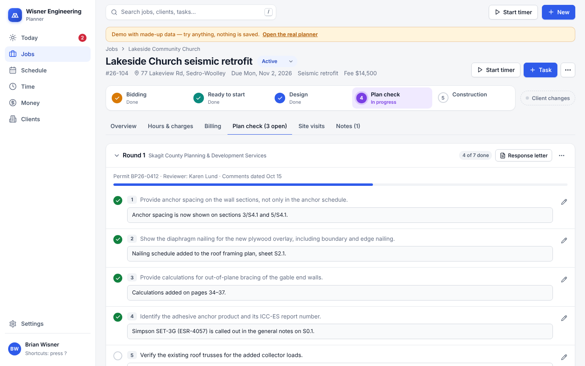
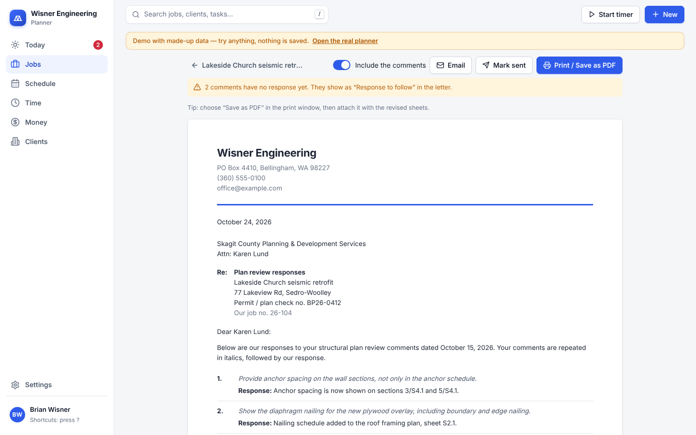
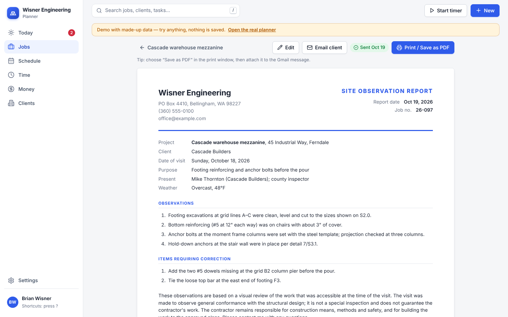
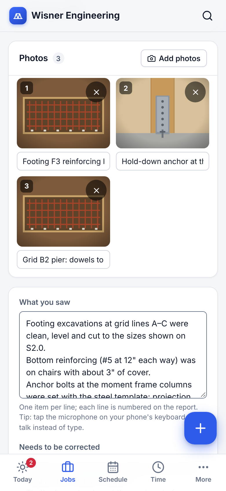

# Wisner Engineering Planner

The project planner for a solo structural engineering business: jobs, schedule, time and billing in one place. It runs in any browser (desktop, laptop, iPhone, iPad), keeps every device in sync, and is free to run.

**Open it:** https://brianwisner.github.io/Planner/ — sign in with your email and password.
**Try it with made-up data (nothing is saved):** https://brianwisner.github.io/Planner/demo/


## What's where

| Page | What it's for |
|---|---|
| **Today** | What needs you now: late items, today's tasks and deadlines, the next 7 days, things you're waiting on, this week's planned hours, and money to act on. Type a task and press Enter to add it for today. |
| **Jobs** | **Board:** every open job in a column for its stage — Bidding, Ready to start, Design, Plan check, Construction, On hold. Drag a card to move the job along; the phases update for you (with Undo). **List:** your priority queue — drag ⋮⋮ to reorder; export to CSV. |
| **A job** | The stage bar at the top (click a stage to move there), tasks, phases with estimates/dates/progress, client contact, scope, planned hours. Tabs for **Hours & charges**, **Billing** (create invoices, deposits, balance chart), **Plan check**, **Site visits** and **Notes**. |
| **Plan check** (on a job) | Paste the reviewer's comment letter: each numbered comment becomes a line to answer and tick off. **Response letter** prints every comment with your response, ready to save as a PDF; **Mark sent** sets the job to waiting on the reviewer. Board cards show how many comments are still open. |
| **Site visits** (on a job) | At the site, tap **New report**: take photos (shrunk on the phone so they upload fast), add captions, and type or dictate what you saw and what needs fixing. It saves as you type. **Report** is a printable site observation report with your letterhead, numbered items and the photos; **Email client** opens Gmail ready to attach the PDF. A scheduled site visit task has a **Start report** button. |
| **Schedule** | **Week plan:** type how many hours you plan on each job each day; totals show against the hours you have, with deadlines on each day. **Timeline:** phases as bars — drag to change dates. **Calendar:** month view (or a list on phones) of deadlines, tasks and site visits. |
| **Time** | Start/stop the timer, or type hours straight into the weekly timesheet. Every entry is listed below with its billing status; export to CSV. |
| **Money** | What's ready to bill, unpaid invoices (with how long they've been out), deposits, and reports: hours by client and job, estimate vs actual, and what you earned per hour. Each invoice has a clean printable page — **Print / Save as PDF**, then **Email client** opens a Gmail message ready to attach it to. |
| **Clients** | Contacts with one-tap call or Gmail, their open jobs and what they owe. |
| **Settings** | Your rate and weekly hours, business defaults, letterhead and signature for reports and letters, light/dark mode, Google Calendar sync, reminders, and how to put the app on your phone. |

| Jobs board | A job | Week plan |
|---|---|---|
|  |  |  |

| Billing on a job | Invoice | Phone |
|---|---|---|
|  |  |  |

| Plan check comments | Response letter | Site visit report | Site visit on a phone |
|---|---|---|---|
|  |  |  |  |

### Handy everywhere

- **New** (top right, or the round **+** button on a phone): log hours, new task, site visit, new job, new client, deposit, charge.
- **Search:** press `/` (or Ctrl/⌘ K) to find any job, client, task or invoice — or type a command like "log hours".
- **Timer:** start it from the top bar, a job page or a task; it shows at the top until you stop it.
- **Undo:** moving a job, ticking a task done, marking an invoice paid and changing a job's status can all be undone from the message at the bottom.
- **Keyboard shortcuts:** press `?` to see them.
- **Dark mode:** Settings → Appearance.

## Put it on your phone

- **iPhone / iPad:** open the address in Safari, tap **Share**, then **Add to Home Screen**. It opens full-screen like an app.
- **Android:** open in Chrome → menu (⋮) → **Add to Home screen**.

## Google Calendar

Settings → **Google Calendar sync** → **Copy**, then **Open Google Calendar** and paste the link into **URL of calendar** → **Add calendar**. Deadlines and site visits then appear in Google Calendar on every device (Google refreshes it a few times a day).

## How it's built (plain English)

- **The app** is a website made with React. GitHub Pages hosts it for free. Every change merged into the default branch is rebuilt and published automatically (`.github/workflows/deploy.yml`).
- **The data** (clients, jobs, hours, invoices…) lives in **Supabase**, a hosted database with logins and live syncing. The project is called `wisner-planner`. Its setup is in `supabase/` (see `supabase/README.md`).
- `planner/.env.production` holds the database address and its *publishable* key, which is designed to be visible in a website: everything sits behind your login and row-level security.
- **The previous design** is still available at https://brianwisner.github.io/Planner/classic/ (folder `classic/`). It uses the same data, so you can switch back and forth. It can be removed once you're happy with this one.

## For developers

```bash
cd planner
npm install
npm run demo     # app with made-up data in memory, no login — use this for testing
npm run dev      # app connected to the real database (needs a .env with the Supabase URL/key)
npm test         # unit tests (money rules, stages, planning, demo database)
npm run build    # type-check + production build
npm run lint
```

Architecture, data rules and conventions are in the repository's `CLAUDE.md`.
